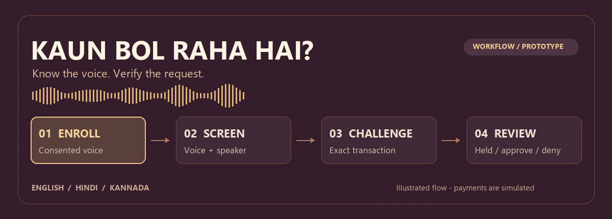
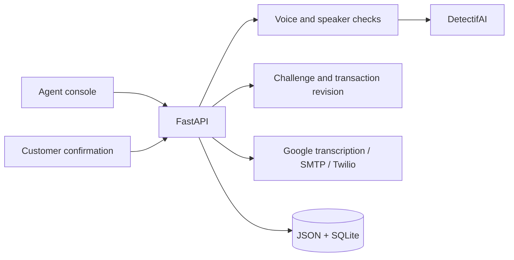

<div align="center">



# Kaun Bol Raha Hai?

**Voice verification. Exact transaction approval. A clearer signal before you act.**


[Quick start](#start-the-app-on-windows) · [Architecture](docs/ARCHITECTURE.md) · [Live setup](BANK_SETUP.md) · [Benchmark](BENCHMARK.md)

</div>

Kaun Bol helps a bank agent screen a caller's voice and ask a customer to approve an **exact test transaction**. Synthetic-voice checks, speaker verification, spoken challenges, and revision-bound approval links contribute separate signals. The agent sees **Held**, **Approved**, or **Denied**. Payments are simulated.

## What it does

- **Voice screening:** upload or record a consented clip; check synthetic speech with Aletheia and the selected speaker with Eidos.
- **Live call guard:** choose a microphone or supported PC audio input, test the signal, and view live guard updates.
- **Exact approval:** bind a customer request to the amount, merchant and transaction revision. Editing details replaces the old approval link.
- **Customer handoff:** use a link or QR, with optional SMTP email, Twilio SMS and SMS OTP.
- **Three languages:** English, Hindi and Kannada customer flows, plus spoken challenges.
- **Reviewable evidence:** number history, incident exports and saved benchmark results.
- **Accessible motion:** short panel and result reveals, responsive buttons, and a reduced-motion alternative.

The animation above illustrates the workflow; it is not a recording of live verification.

## How the pieces connect



Read the [architecture guide](docs/ARCHITECTURE.md) for the full component map, approval sequence, storage lifetimes and trust boundaries.

## Explore the repository

- `backend/`: FastAPI APIs, provider clients, transaction state and tests.
- `frontend/`: browser UI, audio helpers, translations and shared styles.
- [Bank setup](BANK_SETUP.md): live providers, OTP, HTTPS and device rehearsal.
- [Architecture](docs/ARCHITECTURE.md): component map, approval sequence and module guide.
- [Benchmark](BENCHMARK.md): saved results and how to evaluate consented inputs.
- [Private data](data/README.md): runtime files intentionally excluded from Git.

## Start the app on Windows

From this folder, run the following in PowerShell with Python 3.12.

```powershell
python -m venv .venv
.\.venv\Scripts\python.exe -m pip install -r backend/requirements.txt
Copy-Item .env.example .env
$env:DEMO_MODE = "1"
.\.venv\Scripts\python.exe -m uvicorn app:app --app-dir backend --host 127.0.0.1 --port 8003 --workers 1
```

Open http://127.0.0.1:8003. For live checks, set `DEMO_MODE=0` and configure `DETECTIF_API_KEY` plus the providers described in [BANK_SETUP.md](BANK_SETUP.md). Restart after editing the file. Without a key, voice results are labelled Demo. Set `AGENT_PIN` before sharing any deployment.

## Get call audio into the live guard

- For a call on speakerphone, choose the laptop microphone in **Live Call → Live audio input**. **Test input** shows whether the other person's voice is arriving before a check starts.
- When Windows already routes the call to a virtual cable or Stereo Mix, select that device explicitly. If it stays silent while the other person speaks, try the real microphone with the phone on speaker.
- In supported desktop browsers, **Capture PC audio** opens the system share picker. Choose **Entire Screen** and turn on **Share system audio**. Kaun Bol processes audio only and releases the share when the guard stops. Check that **Audio detected** appears while the other person speaks. PC audio capture may include other sounds playing on the computer.
- For a separate recording, use **Check a voice** to upload a consented file. The recording path analyzes a clip after upload.

## Rehearse

1. In **Customers**, enroll a consenting person's voice. To test both Kannada and Hindi with a bilingual person, add both recordings to one profile. Use about 20–30 seconds of clear speech per enrollment sample and keep separate recordings for verification.
2. In **Transaction review**, select the customer, enter a test amount and merchant, choose the challenge language, and click **Place on hold**.
3. Use **Open live call guard** and make the real phone call through Windows Phone Link or a handset on speaker. The app's live call guard listens to the microphone. You can see its audio meter while the customer speaks.
4. Open the customer request in another browser tab, or on a second device via a deployment with HTTPS. Check the amount. Choose **Verify to approve**, allow the microphone, and record all three challenge words. Speak for at least five seconds, repeating the words if necessary. Once they appear in the browser transcript, choose **Approve this exact transaction**.
5. On the desktop, change the amount and select **Save and require new approval**. The new version returns to **Held**. The old link displays that it was replaced. Use the new link to demonstrate **Deny transaction**.

Aletheia checks for synthetic audio. Eidos checks the selected voice profile. For transaction approval, the server requires all three challenge words, a speaker match and an explicit real-voice result. Live mode transcribes the submitted recording through Google Speech-to-Text; demo mode uses the browser transcript and labels its voice checks simulated. A banking deployment would also need an authenticated customer channel. The browser link is a prototype handoff and must be shared manually. Call dialling is separate. Keep both voice clips and the labels for test cases out of public source control.

## Validation and contributing

Run tests from `backend` with `python -m unittest discover -s tests`. The published baseline passed 81 backend tests locally and in GitHub Actions. Browser checks covered desktop and 375 px transaction layouts, panel animation, the reduced-motion CSS override, and console errors. Real phone audio, live providers, and native-language review still require separate rehearsals.

For changes, describe the visible behavior and how you verified it. Check keyboard focus, disabled controls, mobile layouts and reduced-motion behavior after UI changes. Keep credentials, enrolled customer metadata, databases and consented recordings outside Git. See [benchmark notes](BENCHMARK.md) for the prior saved results and evaluation instructions.

<!-- benchmark-summary:start -->
The bundled live snapshot records 5/5 voice decisions and 5/5 speaker decisions across 5 labelled cases. See [BENCHMARK.md](BENCHMARK.md) for the conditions and limitations.
<!-- benchmark-summary:end -->


## Prototype boundaries

Use a single server worker: active calls, challenges, confirmations and transactions live in process memory. Restarting loses that state. Demo mode works without provider keys and clearly marks simulated outcomes. Live mode needs configured services; neither the animation nor the five-case saved benchmark establishes real-world fraud-detection accuracy.

Customer links are short-lived bearer links. Keep the agent surface private, configure `AGENT_PIN`, and follow the customer-host allowlist in [BANK_SETUP.md](BANK_SETUP.md) before exposing a rehearsal over HTTPS. Recordings, customer metadata, credentials and runtime databases are excluded from this repository.
