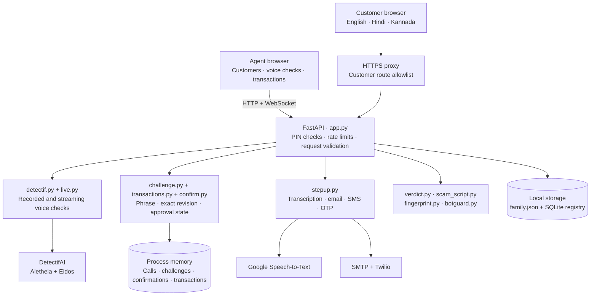
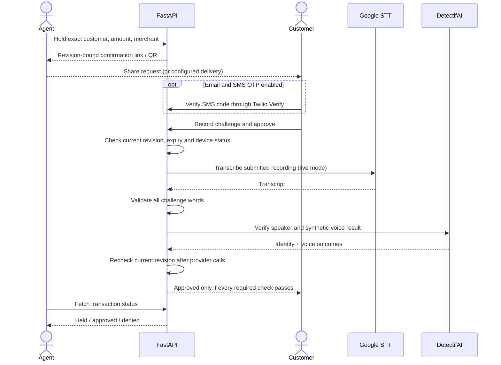

# Architecture

[Home](../README.md) · [Setup](../BANK_SETUP.md) · [Benchmark](../BENCHMARK.md)

Kaun Bol runs one FastAPI process that serves an agent console, a separate customer confirmation surface, HTTP APIs, and the live audio WebSocket. The browser app uses plain JavaScript and CSS; there is no frontend build step.

## Code map

- `backend/app.py`: routes, access checks, request validation, enrollment, transaction orchestration and static assets.
- `backend/detectif.py` and `backend/live.py`: recorded and streaming voice verification, provider calls and labelled demo responses.
- `backend/transactions.py`, `backend/confirm.py`, `backend/challenge.py`: transaction revisions, confirmation lifecycles and spoken challenges.
- `backend/stepup.py`: Google transcription, SMTP, Twilio messaging and Verify.
- `backend/registry.py`: SQLite incidents, number status, device reports and OTP reservations.
- `backend/identify.py`, `backend/verdict.py`, `backend/scam_script.py`, `backend/fingerprint.py`, `backend/botguard.py`: identity resolution, risk, replay and challenge signals.
- `backend/benchmark.py`, `backend/benchmark_gen.py`, `backend/report.py`: evaluation and evidence exports.
- `frontend/index.html` and `frontend/app.js`: agent console and its workflows.
- `frontend/confirm.html` and `frontend/verify.html`: customer confirmation and outbound caller verification.
- `frontend/audio.js`, `frontend/i18n.js`, `frontend/styles.css`: recording helpers, English/Hindi/Kannada text and shared design.
- `frontend/sw.js`: app-shell caching and shared-audio handoff.

## UI motion

Panels and newly inserted verdict cards enter with a short fade and vertical movement. Cards use a brief stagger, and buttons respond to hover and press. Live and recording indicators follow runtime state; animations do not change verification outcomes. `prefers-reduced-motion: reduce` disables animations and transitions while retaining text and color status cues. Hover movement is limited to fine-pointer devices.

Microphone access requires localhost or HTTPS. Browser speech recognition and system-audio capture depend on browser and device support. Run the backend to use the UI; local HTML files alone cannot provide the API or audio flows.

## System map

The proxy and third-party services are deployment dependencies, not bundled services. In demo mode, DetectifAI responses are simulated and transaction transcription uses the browser-supplied transcript.

## Transaction verification

Changing the amount or merchant increments the revision and supersedes the previous confirmation. The transaction path rechecks state after asynchronous provider work so an old request cannot approve a newer revision. Customer denial can interrupt a pending check.

## State and persistence

- `transactions.py` stores active transactions in memory with a one-hour retention window. Each issued confirmation starts a new revision.
- `confirm.py`, `challenge.py`, `live.py`, and related session modules hold short-lived state in the process. Restarting loses active requests and calls.
- `family.json` stores enrolled customer metadata locally. External speaker enrollment is handled by DetectifAI.
- `registry.py` uses SQLite for number history, incidents, lost-device reports, and OTP reservations. Demo and live registries use separate database files.
- The service worker caches the app shell. API responses are not cached; customer confirmation routes send `no-store` headers.

**Use one worker.** Multiple workers or replicas would disagree about current sessions. Shared durable transaction/session state and coordination are prerequisites for horizontal scaling.

## Trust boundaries

The agent surface supports an `AGENT_PIN`; the customer surface uses short-lived bearer links. The configured customer hostname allows only confirmation pages, device APIs, and three shared assets. Preserve the original Host header through the proxy, keep agent routes private, and disable access logs for token-bearing paths. See [deployment instructions](../BANK_SETUP.md).

Live transaction approval requires server-side transcription, an explicit speaker match, an explicit real-voice outcome, and a current confirmation. When OTP is configured, it must also be verified. Missing or failed checks leave the simulated transaction held. Demo checks are labelled simulated.

This is a prototype: payment status is simulated, bearer links are not a complete banking authentication system, and the saved five-case benchmark is not a production accuracy estimate. Live provider access, native-language review, real devices, and deployment configuration need independent verification.
