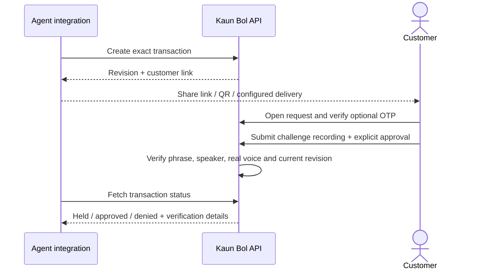

# Integration guide

[Overview](../README.md) · [Architecture](ARCHITECTURE.md) · [Provider and HTTPS setup](../BANK_SETUP.md)

Use this guide to connect an agent dashboard or internal service to Kaun Bol's existing APIs. All routes below are implemented in `backend/app.py`. This prototype records verification decisions and simulated transaction status; it does not execute payments or connect to a payment rail.

## 1. Start an isolated demo

Follow the [quick start](../README.md#start-the-app-on-windows), using Python 3.12 and one Uvicorn worker. Set these values in your local environment or `.env`:

```dotenv
DEMO_MODE=1
AGENT_PIN=<a-long-random-secret>
REQUIRE_SMS_OTP=0
```

Use `http://127.0.0.1:8003` as the agent API base URL. Without `CONFIRM_BASE_URL`, customer links are relative paths suitable for a same-origin localhost rehearsal. Demo results are simulated; they do not evaluate actual voice authenticity.

The current Vercel configuration is for temporary rehearsals. Files live in temporary storage and sessions live in process memory. They can reset or differ across instances. A durable integration needs shared persistent customer, incident, transaction, challenge, confirmation and replay state before it can support reliable multi-request workflows. See [deployment details](../BANK_SETUP.md#vercel-rehearsal-deployment).

## 2. Connect an agent service

Send the agent PIN in the `X-Agent-Pin` header for protected APIs. Keep it in a trusted server integration; do not embed it in a public frontend, repository, URL or customer link. The built-in agent console is a prototype that uses a shared PIN, not a full user/session authentication system.

The following Python snippets run in order in one script. `requests` is included in the backend requirements. Set `AGENT_PIN` in the script's process environment first; standalone scripts do not automatically read `.env`.

```python
import os
from pathlib import Path

import requests

base = os.getenv("KAUNBOL_BASE_URL", "http://127.0.0.1:8003").rstrip("/")
agent = requests.Session()
agent.headers["X-Agent-Pin"] = os.environ["AGENT_PIN"]

def api(method, path, **kwargs):
    response = agent.request(method, base + path, timeout=150, **kwargs)
    response.raise_for_status()
    return response.json()

status = api("GET", "/api/status")
print("Verification mode:", status["mode"])
```

`GET /api/status` itself is unprotected and reports `mode`, `pin_required` and other readiness information. Check `mode` and result-level simulation flags; an HTTP success alone does not establish a live or successful verification.

## 3. Enroll a consenting test customer

Use a clear recording from a consenting speaker, ideally 20–30 seconds, and keep a different recording for verification. Never commit either recording.

```python
with Path("consented-enrollment.wav").open("rb") as audio:
    enrollment = api(
        "POST", "/api/family/enroll",
        data={"name": "Demo Customer", "relation": "Test customer"},
        files={"file": ("enrollment.wav", audio, "audio/wav")},
    )
member_id = enrollment["member"]["id"]
```

`POST /api/family/enroll` accepts multipart fields `file`, `name`, optional `relation`, `phone`, and `member_id`. Supply an existing `member_id` when adding a sample to that profile. `GET /api/family` lists profiles visible in the current demo/live mode.

For delivery integrations, save the customer's registered contact information using `PUT /api/family/{member_id}/phones` with `{"phones": ["<international-number>"]}` and `PUT /api/family/{member_id}/email` with `{"email": "<registered-address>"}`. Use real contacts only in an authorized, appropriately secured environment.

## 4. Screen a recording

```python
with Path("consented-verification.wav").open("rb") as audio:
    check = api(
        "POST", "/api/check",
        data={
            "claimed_member": member_id,
            "number_hidden": "true",
            "auto_detect": "false",
            "demo_scenario": "genuine",
        },
        files={"file": ("verification.wav", audio, "audio/wav")},
    )
print(check["simulated"], check["verdict"]["level"])
```

Provide `caller_number` or explicitly set `number_hidden=true`. Optional fields include `transcript` and `action`. A known speaker claim triggers speaker verification with synthetic-voice checking; an unknown caller can be screened for synthetic speech. The response includes `deepfake`, `identity`, `verdict`, `simulated` and `incident_id`. A screening result does not approve a transaction.

## 5. Create and review an exact transaction

```python
transaction = api("POST", "/api/transactions", json={
    "member_id": member_id,
    "amount_minor": 480000,
    "merchant": "Demo Store",
    "lang": "en",
})
transaction_id = transaction["id"]
revision = transaction["revision"]
```

`amount_minor` must be an integer from 1 through 100,000,000; the UI interprets it as paise, so `480000` displays as ₹4,800. `merchant` is trimmed and must contain 1–80 characters. Supported challenge languages are `en`, `hi` and `kn`; an unsupported value falls back to English.

Creation returns HTTP 201 and a transaction view containing `id`, `revision`, `status`, `verification`, `device_url`, `expires_in`, `simulated_checks` and delivery availability flags. The visible status starts as `held`. Treat `device_url` as a bearer credential: share only with the intended customer, and exclude it from logs and analytics.

Read `GET /api/transactions/{id}` to refresh status. There is no transaction-completion webhook; an integrating dashboard must poll with a bounded interval and stop when the request ends or expires.

Changing transaction details requires the last known revision:

```python
transaction = api("PUT", f"/api/transactions/{transaction_id}", json={
    "revision": revision,
    "amount_minor": 490000,
    "merchant": "Demo Store",
    "lang": "en",
})
revision = transaction["revision"]
```

This creates a new revision, supersedes the previous link, and returns the transaction to `held`. Replace the displayed link/QR and discard any prior approval for the changed transaction. A stale update returns HTTP 409 with `detail.code=transaction_changed`; fetch the current transaction and reconcile before retrying. The create endpoint has no client idempotency key: blindly retrying a timed-out create can produce another transaction.

## 6. Hand off to the customer

Use the returned link with the bundled `frontend/confirm.html` flow. Prefer that existing UI when integrating an agent dashboard: it already implements microphone capture, language selection, OTP, challenge recording and explicit approval/denial.



Agent-side delivery endpoints use a **query parameter** for `revision`, not a JSON body:

- `GET /api/transactions/{id}/qr?revision={revision}` returns SVG, not JSON. Fetch it with the PIN header.
- `POST /api/transactions/{id}/sms?revision={revision}` requests link delivery when SMS-link mode is configured.
- `POST /api/transactions/{id}/email?revision={revision}` requests email delivery when email-plus-OTP mode is configured.
- `POST /api/transactions/{id}/otp?revision={revision}` lets the agent start a configured SMS verification code.

Delivery acceptance does not prove receipt. Do not equate a provider-accepted SMS/email with customer approval.

For a custom customer UI, the implemented device routes are:

- `GET /api/confirm/device/{token}`: request details, expiry, language, challenge and OTP state.
- `POST /api/confirm/device/{token}/language`: JSON `{"lang": "kn"}` or another supported language.
- `POST /api/confirm/device/{token}/otp-start`: start the code flow after accepted email delivery.
- `POST /api/confirm/device/{token}/otp-check`: JSON `{"code": "<customer-entered-code>"}`.
- `POST /api/confirm/device/{token}/approve`: multipart `file`, plus browser `transcript` in demo mode; optional `demo_scenario` selects a simulation.
- `POST /api/confirm/device/{token}/deny`: explicitly deny the request.

Device requests use the bearer token and do not require the agent PIN. Do not send the PIN to the customer origin. In live transaction approval, the server transcribes the same submitted recording through Google and checks all challenge words, speaker match and an explicit real-voice result. In demo mode it uses the submitted browser transcript and simulated voice results. OTP must also be verified when enabled. Revisions and request state are checked again after asynchronous provider calls.

Normal confirmation links expire after 90 seconds; the configured email/OTP flow initially uses a five-minute link, and successful OTP verification renews its challenge. Always read `expires_in`. Inspect `verification` and `result` as well as visible `status`: failed, expired, replaced or revoked requests remain visibly `held`, while a confirmed request maps to `approved` and a customer rejection maps to `denied`.

## 7. Connect live providers

The complete environment template is [`.env.example`](../.env.example). Provider configuration lives on the server:

- **DetectifAI:** set `DETECTIF_API_KEY` and `DEMO_MODE=0`. `backend/detectif.py` implements enrollment, verification, detection, deletion and labelled demo responses. Provider request idempotency is internal to that client; it does not make transaction creation idempotent.
- **Google transcription:** set `GOOGLE_CLOUD_PROJECT`, enable Speech-to-Text, and provide Application Default Credentials with the required speech access. `stepup.py` uses Chirp 2 in `europe-west4`. A project ID alone does not supply credentials. A local credentials-file path will not exist automatically on a remote deployment.
- **SMS links:** configure `TWILIO_ACCOUNT_SID`, `TWILIO_AUTH_TOKEN`, and `TWILIO_FROM_NUMBER` or `TWILIO_MESSAGING_SERVICE_SID`.
- **Email plus SMS OTP:** set `REQUIRE_SMS_OTP=1`, `TWILIO_VERIFY_SERVICE_SID`, and `SMTP_HOST`, `SMTP_PORT`, `SMTP_USERNAME`, `SMTP_PASSWORD`, `SMTP_FROM_EMAIL`. Save the customer's registered email and phone first. This mode uses the email/Verify flow rather than the SMS-link shortcut.
- **Customer origin:** set `CONFIRM_BASE_URL` to a separate HTTPS origin with no path, query or fragment. Keep the agent origin private and preserve Host headers through the proxy. The customer-host allowlist blocks agent endpoints. Follow [BANK_SETUP.md](../BANK_SETUP.md) for allowed paths, proxy and logging configuration.

Restart or redeploy after changing environment variables. Keep credentials out of Git and public browser bundles. Never claim demo checks are live because email or SMS happens to use a live provider.

## 8. Live audio and phone-system adapters

`/ws/live` accepts binary mono PCM16 little-endian audio at 16 kHz, plus JSON text messages such as `{"type":"transcript","text":"..."}` and `{"type":"stop"}`. Query options include `member`, `number`, `hidden`, `scenario` and `auto`. The server emits multiple event types; use `frontend/app.js` and `backend/live.py` as the protocol reference.

The built-in browser authenticates its socket through `Sec-WebSocket-Protocol` using `kb.` followed by the hex encoding of the PIN's UTF-8 bytes. Hex is an encoding, not encryption: use WSS, protect the agent origin, and do not log the header. HTTP PIN headers and URL query PINs are not substitutes for that socket protocol. Vercel connections are duration-limited and cross-instance session recovery is not implemented in this prototype.

`POST /api/calls/incoming` accepts JSON fields `from` and `call_id`, or form fields such as `From` and `CallSid`. It supplies caller metadata to the console; it does not dial a call or provide audio streaming. `GET /api/calls/pending?after={last_id}` reads recent events for authenticated agents.

Set `INCOMING_TOKEN` before exposing an incoming-call adapter; the existing handler expects it in the `token` query parameter. Keep that integration endpoint private and redact token-bearing URLs. Provider webhook signature verification is not implemented by this handler; an authenticated adapter or gateway must validate the upstream event before forwarding it.

## 9. Handle failures and verify the integration

Most application errors use `{"detail":{"code":"..."}}`; validation failures may instead include FastAPI's `detail` array. Check HTTP status and response shape before reading a code.

- **401:** missing/wrong agent PIN, incoming token, or provider authentication failure. Check `detail.code` to identify the source.
- **404:** missing or unavailable profile/request/transaction; it can also indicate a blocked route on the customer hostname.
- **409:** stale revision, non-pending request, unavailable OTP/delivery, or another state conflict. Refresh state instead of replaying an approval.
- **413:** upload exceeds the application or hosting limit. The backend reads up to 25 MiB, but a host can enforce a smaller request limit.
- **422:** invalid payload or field values.
- **429:** rate limit; respect `Retry-After` when present.
- **502:** provider failure. Surface an inconclusive/held result rather than manufacturing approval.

Verify enrollment, genuine/demo screening, denial, expiry, amount changes, stale links and missing provider results. Include replacing a request while a check is running. Test SMS/email delivery on an actual handset, live speech transcription and consented voice inputs separately from offline tests. Do not issue real payments based on this prototype's approval status.

Run `python -m unittest discover -s tests` from `backend/` for the existing automated suite. For live evaluation, use the consent and budgeting instructions in [BENCHMARK.md](../BENCHMARK.md).
